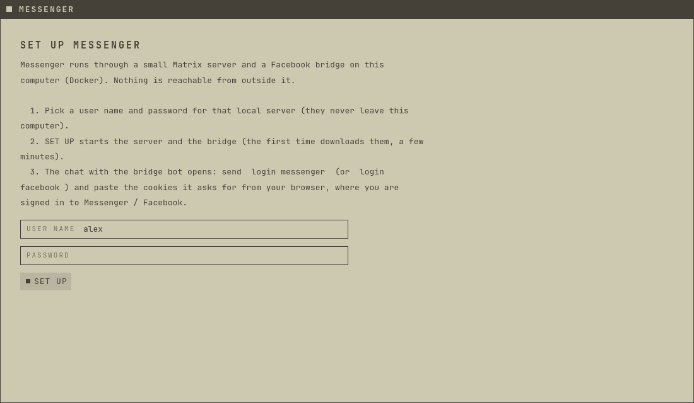
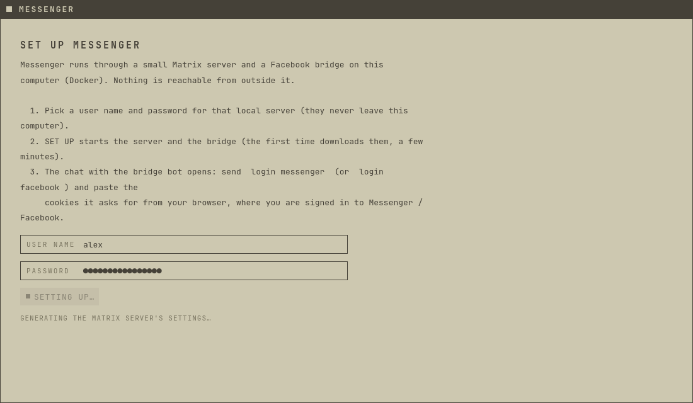
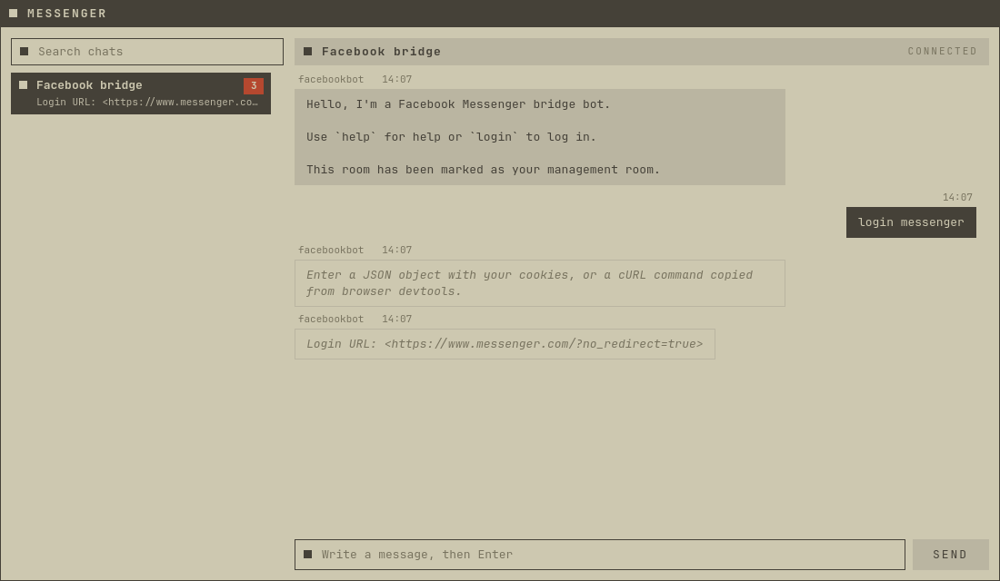

# ProjectNier

A full-screen desktop shell for Hyprland in the style of the menu screens of *NieR: Automata*, built with plain
[Quickshell](https://quickshell.org). The whole desktop is one "screen": tabs along the top (Entertainment,
Missions, Communication, Console, Archive, Network, Configuration, System, Logout), each with its sub-functions on
the left, an information panel in the middle and a content window on the right where the sub-function's app runs.

Built in: a Messenger client (Facebook, through a local Matrix bridge), Gmail, a Bluetooth manager, a notification
daemon with reply buttons, a lock screen, Quick Settings, a health light with a Repair button, and a search box that
finds apps, sub-functions and menus.

## Requirements

- **Hyprland 0.57+** with its Lua config (`hyprland.lua`), and **Quickshell 0.3**
- **JetBrainsMono Nerd Font**
- kitty, jq, python3 with **python-gobject**, curl, NetworkManager (`nmcli`), bluez (`bluetoothctl`), PipeWire
  (`wpctl`, `pactl`), playerctl, power-profiles-daemon, grim, slurp, wl-clipboard, libnotify, dolphin
- Optional:
  - **Docker** + docker compose: Messenger
  - **KeePassXC** (or another Secret Service keyring) + `secret-tool`: mail passwords in a keyring instead of a file
  - hyprsunset (night light), gwenview, chromium, firefox, btop

`install.sh` lists what is missing; it does not install packages.

## Install

```sh
git clone <this repo> ~/dotfiles
cd ~/dotfiles
./install.sh --dry-run     # shows what it would do
./install.sh
```

It links `~/.config/quickshell/ProjectNier` and `~/.config/hypr/projectnier.lua` to this repo, creates
`~/.config/hypr/hyprland.lua` (which loads `projectnier.lua`) and `~/.config/hypr/local.lua`, and copies the
Messenger bridge recipe to `~/.local/share/projectnier/messenger-bridge`. Anything already in the way is moved
aside as `<name>.pre-projectnier-<time>`, never deleted. Running it again changes nothing.

Then log out and back in to Hyprland. **System → Self Check** tells you whether everything is in order.

### Your own Hyprland settings

`projectnier.lua` holds the shared settings (key bindings, window rules the shell relies on). Put anything that is
only for your machine in `~/.config/hypr/local.lua` (see `hypr/local.lua.example`): monitors, devices, and
programs to start at login. It is not part of the repo. If you had a `hyprland.lua` before, it is next to the new
one as `hyprland.lua.pre-projectnier-<time>`.

Hyprland reloads by itself only when `hyprland.lua` changes; after editing `projectnier.lua` or `local.lua`, run
`hyprctl reload`.

## Messenger

Open **Communication → Messages**. Without a login it shows **SET UP MESSENGER**:

1. Pick a user name and a password. They are for a small Matrix server on your own computer, not for Facebook,
   and never leave it.
2. **SET UP** starts the server and the Facebook bridge in Docker (the first time downloads their images, a few
   minutes). Everything listens on `127.0.0.1` only.
3. The chat with the bridge bot opens. Send `login messenger` (or `login facebook`).
4. The bot asks for your browser cookies. In a browser where you are signed in to messenger.com: open the developer
   tools (F12) → **Network**, reload the page, right-click any request to `www.messenger.com` → **Copy → Copy as
   cURL**, and paste that into the bot chat.

Your chats then appear in the list. The bot chat disappears again once Facebook is connected, and comes back if
Facebook ever logs the bridge out (the health light then says FACEBOOK LOGGED OUT).

| | | |
|---|---|---|
|  |  |  |

Your user must be allowed to use Docker (in the `docker` group; log out and in after adding it). From a terminal,
`~/.local/share/projectnier/messenger-bridge/setup.sh <name>` does the same as the button.

## Email

**Communication → Email** asks for a Gmail address and an **app password** (Google account → Security → 2-Step
Verification on → App passwords). If a keyring such as KeePassXC is running (Secret Service integration on), the
password goes there; otherwise into `~/.config/projectnier/mail.json`, readable only by you.

## What stays on your machine

Never in this repo: `~/.config/fbtui/session.json` (Messenger login), `~/.config/projectnier/mail.json` (mail
accounts), the bridge's data (`~/.local/share/projectnier/messenger-bridge/synapse`, `meta`, `.env`),
`~/.local/share/ProjectNier/` (your app list, notes, to-dos), `~/.config/hypr/local.lua`.

## Updating

`git pull` in `~/dotfiles`. The shell reloads by itself; for Hyprland run `hyprctl reload`.

## License

MIT, see [LICENSE](LICENSE).
